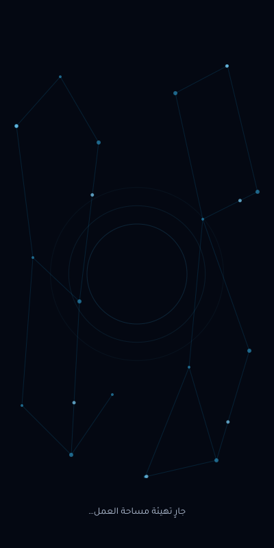

# تصحيح الفترة الفارغة قبل افتتاحية Flutter

[تنزيل حزمة التحديث](network-copilot-startup-network-20261113.zip?raw=true) · [بصمة SHA256](network-copilot-startup-network-20261113.sha256) · [تقرير التحقق](verification.json)

المعاينة التالية مولدة من مسارات الموارد، وليست لقطة من هاتف. مرحلة Android الأصلية ثابتة؛ تبدأ الحركة عندما يصبح Flutter جاهزًا. قبول Samsung Android 10 ما زال مطلوبًا.



# التمهيد الشبكي قبل Flutter — تحديث متابعة 13 نوفمبر 2026

يعالج هذا التحديث الفترة الكحلية الفارغة التي ظهرت في تجربة هاتفك بعد الإصلاح الأول. تظهر الآن شبكة ونص تهيئة من نافذة Android الأولى، ثم يكمل Flutter الهوية والحركة. الشعار الرئيس يبقى داخل Flutter ليظهر مرة واحدة. هذه ليست إضافة انتظار: لا مؤقت جديد ولا تأخير مقصود لأول إطار. الرسم السابق لجاهزية المحرك ثابت، والحركة تبدأ عند جاهزية Flutter. لم يُثبت هذا التعديل تسريع زمن تجهيز المحرك نفسه.

الحزمة تعدل ثمانية موارد Android وملف docs/current-status.md فقط. تستخدم خط Tajawal الموجود بوصفه مصدر أشكال الحروف، دون تنزيل خطوط أو تبعيات. لا تتغير ملفات Dart أو الحسابات أو الاتصال أو مخطط البيانات أو Gradle أو التوقيع.

## التطبيق

فك الحزمة في `D:\copilot-startup-network`. أغلق أي Flutter run أو بناء جارٍ. أبقِ خادم Node وDocker وCHR يعملون، ثم:

```powershell
node "D:\copilot-startup-network\install.cjs" "D:\NetWork-Ai"
```

يدعم المثبت مصدر 0.7 في حزمة التسليم الأصلية، وكذلك المصدر بعد إصلاح 12 نوفمبر. يتحقق من كل تعديل قبل الكتابة، ويرفض الملفات المحلية المجهولة، ويحفظ البايتات الأصلية في نسخة جديدة تحت .copilot-update-backups دون المساس بنسخك السابقة. احتفظ بمسار Backup الذي يطبعه. لا تكمل البناء إذا توقف المثبت.

## البناء والتثبيت من الكاش

الهاتف متصل ومصرّح له عبر USB والخادم يعمل:

```powershell
powershell -NoProfile -ExecutionPolicy Bypass -File "D:\copilot-startup-network\build-phone.ps1" -ProjectRoot "D:\NetWork-Ai"
```

يستدعي Gradle 9.3.1 من الكاش مباشرة بوضع offline وبأوامر البناء المحلية السابقة نفسها. لا يشغّل wrapper 9.1.0 أو يغيره، ويمنع تنزيل SDK وJava آليًا. بعد نجاح البناء يثبت بـadb install -r بإعدادات التوقيع المحلية القائمة، ويتحقق من توجيه USB 3443، ثم يغلق عملية التطبيق ويفتحها ببدء بارد باستخدام am start -W. إغلاق العملية لا يمسح البيانات. قد يطبع Android ThisTime وTotalTime وWaitTime؛ هذه مؤشرات رسم نافذة التطبيق وليست زمن جلب الحساب كاملًا.

إذا ظهرت مشكلة مساحة بعد BUILD SUCCESSFUL، احتفظ بـAPK الناتج وبالتطبيق الحالي. وفّر مساحة داخلية قبل إعادة محاولة التثبيت؛ لا تحذف التطبيق أو بياناته لتجاوز المشكلة. لا تنظف الكاش أو تعِد تجهيز المالك أو المصادقة أو قاعدة البيانات.

## عند فقد اتصال USB

ظهور device لا يكفي: يجب أن تتضمن reverse --list توجيه tcp:3443 إلى tcp:3443. بعد إعادة توصيل الكابل أو إعادة تشغيل ADB يمكن إعادة الربط دون بناء أو تثبيت:

```powershell
powershell -NoProfile -ExecutionPolicy Bypass -File "D:\copilot-startup-network\connect-phone.ps1"
```

رجوع الأمر إلى السطر طبيعي؛ الربط يعمل في الخلفية. تبقى نافذة خادم Node عاملة. الشهادة والحساب وTOTP الحاليون يستمرون كما هم؛ لا تُنشأ شهادة أو هوية جديدة في هذا التحديث.

## القبول على Samsung Android 10

1. عند البدء البارد تظهر الشبكة ونص التهيئة، دون فترة لون فارغة أو ومضة بيضاء.
2. يكتمل ظهور الهوية المتحركة مرة واحدة دون شعار ثابت منفصل أو انتظار مصطنع. بداية الحركة تعتمد على جاهزية Flutter الفعلية.
3. تُستعاد الجلسة، وينجح فحص الصحة، وتستمر العودة من الخلفية؛ راجع المظهرين وتقليل الحركة.

القبول السابق للحساب والفحص والعودة من الخلفية مسجل بحسب تجربتك. قبول التمهيد الجديد ما زال مطلوبًا؛ لا يغلقه تجميع الموارد أو المعاينات.

## الرجوع

أغلق أي بناء أو Flutter run، واستخدم نسخة هذا التحديث بالضبط:

```powershell
node "D:\copilot-startup-network\rollback.cjs" "D:\NetWork-Ai" "مسار Backup المطبوع لهذا التحديث"
```

ثم أعد البناء والتثبيت بالسكربت نفسه لاستعادة الموارد السابقة على الهاتف. إذا كان خط الأساس هو الإصلاح الأول فستعود خلفيته الكحلية السابقة. الرجوع يرفض الكتابة فوق تعديل أحدث أو استخدام نسخة تخص تحديثًا آخر. لا توجد ترقية بيانات أو خطوة رجوع لقاعدة البيانات.

## حدود التحقق

verification.json يميز فحوص هذه الحزمة من الاختبارات التاريخية. نجح تجميع وربط الموارد وفحص المعاينات الثابتة المولدة من المسارات. لم يُبنَ APK كامل أو تُجرّب هذه الموارد على هاتف في بيئة التطوير، ولم تُعد اختبارات Flutter لغياب SDK. اختبارات الخادم الـ84 السابقة بقيت دليلًا سابقًا، ومصدر الخادم لم يتغير. سكربتات Windows تحتاج التنفيذ على جهازك بكاشك وتوقيعك الحاليين.
